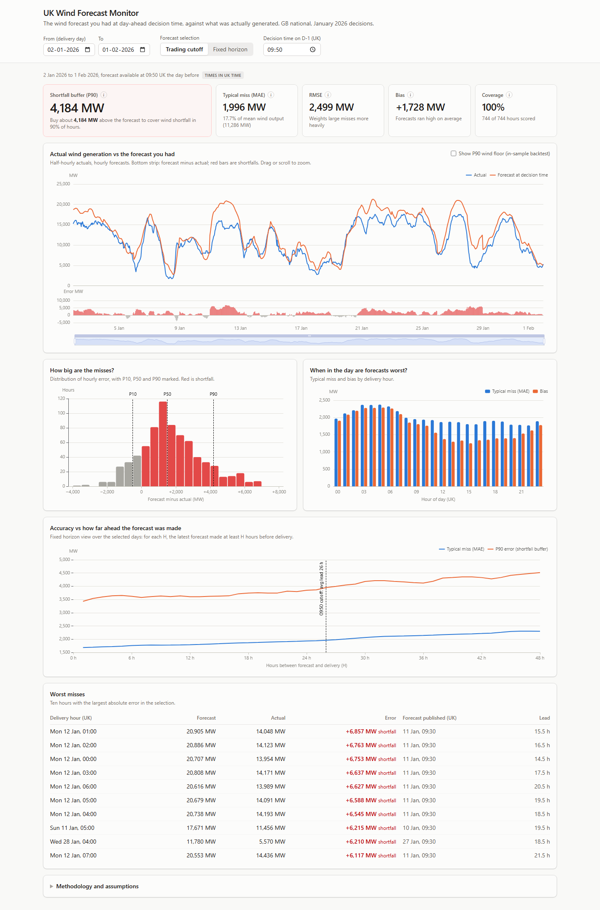

# UK Wind Forecast Monitor

A dashboard for a GB day-ahead trading team. It shows the wind forecast they actually had when
the day-ahead auction closed (09:50 UK time on the day before delivery), compares it with what the
wind fleet generated, and turns the error into a number they can act on:
**how many MW above the forecast to buy to cover a wind shortfall in 90% of hours.**

Scope is the brief's: national wind only, Elexon BMRS `FUELHH` (actuals) and `WINDFOR` (forecasts),
for purchase decisions made in January 2026.

**Live demo:** _TODO: Vercel URL_



## Headline result

With the 09:50 cutoff, over delivery days 2 Jan to 1 Feb 2026 (744 hourly points, 100% coverage):

- Buying **~4,200 MW above the forecast** would have covered the wind shortfall in 90% of hours.
- MAE was 1,996 MW (17.7% of mean wind output). Forecasts ran **1,728 MW high on average**,
  most likely because WINDFOR forecasts available wind while FUELHH measures output after
  curtailment. See [docs/DATA_NOTES.md](docs/DATA_NOTES.md).
- Accuracy decays with lead time: MAE goes from 1,685 MW one hour ahead to 2,301 MW 48 hours ahead.

## Run it

**Docker, development (hot reload on both sides):**

```bash
docker compose up
# frontend http://localhost:5173 , API http://localhost:8000/docs
```

**Docker, production image (one container serves the SPA and the API):**

```bash
docker build -t wind-forecast-monitor .
docker run -p 8000:8000 wind-forecast-monitor
# http://localhost:8000
```

**Without Docker** (Python 3.12, Node 20):

```bash
cd backend
python -m venv .venv && source .venv/bin/activate   # Windows: .venv\Scripts\activate
pip install -r requirements-dev.txt
uvicorn app.main:app --reload            # http://localhost:8000

cd ../frontend
npm ci
npm run dev                              # http://localhost:5173 (proxies /api to :8000)
```

**Re-ingest the data** (optional; the processed file is committed):

```bash
pip install -r backend/requirements-dev.txt
python backend/scripts/ingest.py         # defaults: delivery days 2026-01-02 to 2026-02-01
```

## API

Interactive docs at `/docs`. All endpoints are `GET` under `/api/v1`, return UTC ISO 8601 times
and MW values, and share these query params: `start`, `end` (UK delivery days),
`mode` (`cutoff` or `horizon`), `cutoff_time` (`HH:MM` UK time, default `09:50`),
`horizon_hours` (1 to 48, default 24).

| Endpoint | Returns |
|---|---|
| `/health` | Status and row counts |
| `/meta` | Available range, defaults, notes (drives the UI) |
| `/series` | Half-hourly actual, selected forecast, its publish time and lead time, error |
| `/metrics` | Summary (MAE, RMSE, bias, P10/P50/P90, shortfall buffer, n, coverage) and breakdowns by hour, lead time and day, plus worst misses |
| `/accuracy-by-horizon` | MAE, RMSE and P90 for H = 1 to 48 hours |

## Key assumptions

Full reasoning in [docs/DECISIONS.md](docs/DECISIONS.md).

1. Decisions on 1 to 31 Jan mean delivery days 2 Jan to 1 Feb.
2. "Latest forecast at decision time" = latest `publishTime` at or before 09:50 UK on D-1
   (Nord Pool N2EX gate closure). Configurable; a horizon mode shows accuracy H hours ahead.
   A test checks that no selected forecast is ever published after its cutoff.
3. Forecasts are hourly and actuals half-hourly; only on-the-hour points are scored. No interpolation.
4. `error = forecast - actual`; positive means wind fell short (the costly direction).
5. No MAPE (it explodes near zero output). Normalised MAE uses mean actual generation.
6. Missing data stays `null` and shows as a gap; nothing is zero-filled.
7. Data is fetched once and committed; the API never calls Elexon per request.

## Repository guide

```
.
├── backend/
│   ├── app/
│   │   ├── main.py            App factory: middleware (request id, timing, gzip, cache headers), routes, SPA mount
│   │   ├── config.py          Settings and defaults (env prefix WFM_)
│   │   ├── logging.py         JSON log formatter
│   │   ├── api/v1.py          Route handlers: validation and response shaping only
│   │   ├── schemas.py         Pydantic response models (the API contract)
│   │   ├── data_store.py      Loads the SQLite file into memory once
│   │   ├── service.py         Wires selection and metrics together; per-parameter cache
│   │   ├── selection.py       Delivery window, cutoffs, forecast selection (one merge_asof)
│   │   └── metrics.py         Pure metric functions
│   ├── scripts/
│   │   ├── ingest.py          Async chunked fetch from Elexon, writes data/wind_jan2026.sqlite
│   │   └── cleaning.py        Pure cleaning and dedupe rules
│   ├── data/wind_jan2026.sqlite   Processed data (committed)
│   ├── tests/                 pytest: selection, metrics, cleaning, API
│   ├── requirements.txt       Runtime deps (Docker)
│   ├── requirements-dev.txt   + ingest, test and lint deps
│   └── pyproject.toml         Runtime deps for Vercel, ruff and pytest config
├── frontend/
│   ├── src/api/               Typed API client and TanStack Query hooks
│   ├── src/hooks/             URL-backed filter state
│   ├── src/components/        Controls, KPI tiles, charts, tables
│   ├── src/lib/               Formatting and time helpers
│   └── vite.config.ts         Dev proxy /api -> backend, Vitest config
├── docs/
│   ├── ARCHITECTURE.md        Diagram and request flow
│   ├── DECISIONS.md           D1 to D9: each ambiguity and what we chose
│   └── DATA_NOTES.md          What the Elexon data actually looks like, and findings
├── scripts/check_deps_sync.py CI check: Vercel and Docker dependency lists match
├── Dockerfile                 Multi-stage production image
├── docker-compose.yml         Local development
├── vercel.json                Vercel services (frontend, backend) and routing
├── CLAUDE.md                  The plan given to Claude Code (kept for transparency)
└── .github/workflows/ci.yml   Lint, tests, builds, Docker smoke test
```

## Testing and CI

- **Backend (pytest, 98% coverage):** forecast selection, including a randomised check against a
  brute-force reference that no selected forecast was published after its cutoff and that it is
  always the latest eligible one; DST-safe cutoffs; metrics against hand-computed values,
  empty and all-null input; cleaning rules; API happy paths, parameter echo and 422s.
  All tests run offline against fixtures or the committed data file.
- **Frontend (Vitest):** URL state parsing, formatting helpers, a component render.
- **CI (GitHub Actions):** ruff lint and format, pytest with coverage, dependency sync check,
  TypeScript typecheck, ESLint, Vitest, production build, Docker build plus a smoke test of the
  running container.

## Deployment trade-offs

Vercel hosts the demo as one project with two services: the static app on the CDN, and the API as
one Python function with the 1.7 MB data file bundled. `/api/*` routes to the API on the same
domain, so there is no CORS. Cold starts take a couple of seconds (pandas import). The same code
ships as a Docker image, so moving to Heroku, Fly or a VM is a `docker run` with `$PORT`, with no
code changes. For a real product with live data we would run the container and a scheduled ingest
instead.

## Limitations and next steps

- **Live pipeline:** scheduled ingest (each WINDFOR publish) into Postgres instead of a static file.
- **Explain the bias:** add balancing data (BOAs) to separate curtailment from weather error.
- **Cost-weighted error:** weight shortfalls by imbalance or intraday prices, since a shortfall at
  peak costs more than one overnight.
- **Out-of-sample buffer:** compute the buffer from a trailing window (for example the previous
  30 days) and backtest it, instead of describing the same month.
- **Probabilistic view:** buffers by hour of day and by forecast level, not one number for the month.
- **Alerting** when today's forecast spread or recent error is unusually high.

## AI tools used

This project was built with **Claude Code** (Anthropic), working from the plan in `CLAUDE.md`,
which I wrote and reviewed. Claude Code was used for: exploring the Elexon API, scaffolding,
writing the backend and frontend code and tests, and drafting docs. I made and reviewed the
domain decisions (cutoff definition, error sign, P90 buffer, scope), checked the data findings,
and reviewed the code before committing.
