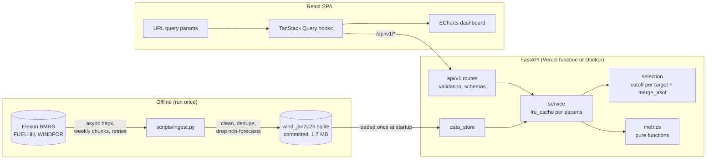

# Architecture

## Overview

## Request flow (`GET /api/v1/metrics?mode=cutoff&cutoff_time=09:50`)

1. Middleware assigns a request id and starts a timer.
2. `common_params` validates the query (date range inside the data, `HH:MM` cutoff, horizon 1 to 48)
   and builds a frozen, hashable `Query`. Bad input returns 422 with a readable message.
3. `service.metrics_report(query)` is `lru_cache`d. On a miss it calls `service.series(query)`
   (also cached), which:
   - builds the half-hourly target grid for the UK delivery days,
   - computes a cutoff per target (`selection.cutoffs_for_targets`),
   - picks the latest forecast at or before each cutoff with one `merge_asof`
     (`selection.select_forecasts`),
   - left-joins actuals and computes `error_mw = forecast - actual`.
4. `metrics.*` reduce that frame to the summary and breakdowns. They are pure functions of a
   DataFrame, which is why they are easy to unit test.
5. The response is validated against the Pydantic model, gzipped, and sent with
   `Cache-Control: public, s-maxage=86400` (the data is immutable, so the CDN can cache it),
   `X-Request-ID` and `X-Response-Time`. One JSON log line is written per request.

Typical latency: under 50 ms uncached, ~2 ms cached. `/accuracy-by-horizon` runs 48 selections
(~0.5 s) the first time and is cached after that.

## Module map

| Module | Responsibility | Depends on |
|---|---|---|
| `backend/scripts/ingest.py` | Fetch from Elexon, call cleaning, write SQLite | httpx, tenacity |
| `backend/scripts/cleaning.py` | Pure cleaning and dedupe rules (D6) | pandas |
| `backend/app/data_store.py` | Read SQLite once, typed frames in memory | sqlite3, pandas |
| `backend/app/selection.py` | Delivery window, cutoffs, forecast selection (D1 to D3) | pandas |
| `backend/app/metrics.py` | Error metrics and breakdowns (D4, D5) | numpy, pandas |
| `backend/app/service.py` | Wire the above together, cache per parameter set | the above |
| `backend/app/api/v1.py` | HTTP: params, validation, response shaping | service, schemas |
| `backend/app/main.py` | App factory, middleware, static SPA mount | FastAPI |
| `frontend/src/api` | Typed client and query hooks | TanStack Query |
| `frontend/src/hooks` | URL-backed filter state | |
| `frontend/src/components` | Controls, KPI tiles, charts, tables | ECharts |

## Deployment

- **Vercel:** `pyproject.toml` points `tool.vercel.entrypoint` at `api/index.py`, which imports the
  FastAPI app. `vercel.json` builds the frontend first; the app mounts `frontend/dist` with
  `StaticFiles`, and Vercel promotes it to the CDN. The SQLite file ships inside the function bundle.
- **Docker:** a multi-stage `Dockerfile` builds the frontend with Node, then copies `dist` into a
  `python:3.12-slim` image that serves both on `$PORT`. CI builds the image and smoke tests it.
- **Local dev:** `docker compose up` runs uvicorn with reload and the Vite dev server, which proxies
  `/api` to the backend.
